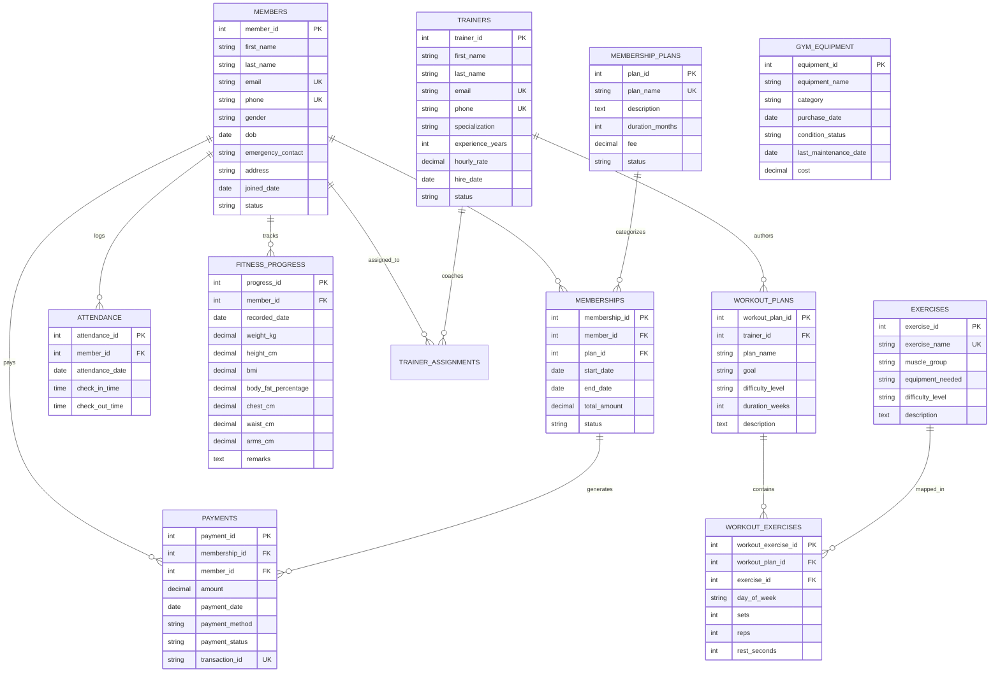

# FitTrack – Smart Gym Management & Fitness Tracking System
## DBMS Capstone Project Report & Technical Specification

---

### Project Metadata
- **Project Title:** FitTrack – Smart Gym Management & Fitness Tracking System
- **Domain:** Relational Database Management Systems (RDBMS) / Enterprise Gym Operations & Biometrics
- **Database Engine:** MySQL 8.x / 8.4 LTS (InnoDB Engine)
- **Backend Stack:** Node.js v22, Express.js 5, mysql2 connection pool
- **Frontend Stack:** HTML5, Modern CSS3 (Dark Gym Aesthetics), Vanilla JavaScript, Chart.js 4
- **Normalization Level:** Fully Certified up to Third Normal Form (3NF)
- **Architecture:** Decoupled Model-View-Controller (MVC) / Client-Server Relational Model

---

## 1. Project Abstract

In the modern health and wellness industry, commercial gyms and fitness centers handle complex multi-faceted workflows involving member registrations, trainer allocations, periodic subscription plans, financial transactions, daily attendance, biometrics tracking, and workout periodization. Traditional gyms frequently rely on fragmented spreadsheets or paper registers, causing data redundancy, lack of referential integrity, lost renewal revenues, and inaccurate fitness evaluations.

**FitTrack** is an enterprise-grade Relational Database Management System (RDBMS) capstone project engineered to centralize, streamline, and automate gym operations. Built on **MySQL 8** with strict **Third Normal Form (3NF)** compliance, the system manages 12 interrelated tables governing Members, Trainers, Membership Plans, Subscriptions, Exercises, Workout Plans, Workout Mappings, Trainer Assignments, Daily Attendance, Financial Payments, Biometrics Progress, and Gym Equipment Assets. FitTrack incorporates advanced relational database concepts including ACID transactions with commit/rollback recovery, automatic calculation triggers, user-defined functions (UDFs), database views, Common Table Expressions (CTEs), and window functions. Coupled with a responsive web dashboard and an interactive live DBMS demonstration console, FitTrack provides a university-standard capstone solution.

---

## 2. Problem Statement

Commercial fitness clubs encounter severe operational and architectural database challenges:
1. **Data Redundancy & Anomalies:** Storing member personal details along with multiple payment records or trainer logs in denormalized spreadsheets leads to update anomalies, deletion anomalies, and insertion anomalies.
2. **Missing Relational Constraints:** Lack of declarative Foreign Key enforcement results in orphaned attendance and billing records when members or trainers depart.
3. **Absence of Atomic Transactions:** Subscribing a member requires simultaneous member insertion, subscription assignment, and invoice creation. If any step crashes without transactional rollback, inconsistent financial data results.
4. **Manual Biometric & Expiry Tracking:** Manual identification of expired subscriptions or manual calculation of Body Mass Index (BMI) wastes administrative labor and introduces human calculation errors.
5. **No Data-Driven Analytics:** Management lacks instant queries to rank trainer workload, detect attendance bottlenecks, compute month-over-month revenue, and monitor equipment maintenance cycles.

FitTrack directly resolves these challenges by implementing an architected relational database model with strict integrity constraints, stored procedures, triggers, and analytical views.

---

## 3. Project Objectives

1. **Relational Normalization:** Design a normalized 3NF schema containing 12 distinct tables, removing partial and transitive functional dependencies.
2. **Referential Integrity Enforcement:** Implement Primary Keys, Foreign Keys, `CASCADE` / `RESTRICT` rules, `UNIQUE` constraints, `CHECK` constraints, and `DEFAULT` values.
3. **Business Logic Automation via Triggers & UDFs:** Automate BMI calculations on biometrics insertion (`trg_before_insert_fitness_progress`), maintain active member flags (`trg_after_membership_insert`), and provide re-usable functions (`fn_calculate_bmi`, `fn_get_member_total_spent`).
4. **ACID Transactions:** Implement atomic Stored Procedures (`sp_register_member_with_membership`, `sp_renew_membership`, `sp_record_attendance`) with `START TRANSACTION`, `SAVEPOINT`, `COMMIT`, and `ROLLBACK` error handlers.
5. **Advanced SQL Analytical Querying:** Demonstrate practical mastery of multi-table `INNER`/`LEFT`/`RIGHT` Joins, `GROUP BY` with `HAVING`, correlated subqueries, Common Table Expressions (CTEs), and Window Functions (`LAG`, `DENSE_RANK`, `ROW_NUMBER`).
6. **Full-Stack Dashboard:** Provide an intuitive, real-time web dashboard connected to MySQL 8 via `mysql2/promise` with zero dummy data.

---

## 4. Scope of the Project

The system encompasses the following operational domains:
- **Member Management:** Registration, contact details, emergency contacts, status lifecycles (Active, Inactive, Suspended).
- **Trainer & Coaching Operations:** Specialization directories, hourly compensation, client capacity, assignment scheduling.
- **Membership Catalog & Subscriptions:** Multi-duration packages (1, 3, 6, 12 months), subscription tracking, automated upcoming expiration alerts.
- **Biometrics & Fitness Tracking:** Longitudinal tracking of weight, height, body fat %, waist, chest, arms, and trigger-computed BMI.
- **Workouts & Exercise Library:** Standardized muscle-group exercises with junction mapping to periodized workout routines with sets, reps, and rest intervals.
- **Smart Attendance Terminal:** Procedural check-in and check-out tracking gym session durations.
- **Financial Ledger & Billing:** Multi-channel fee collection (UPI, Credit Card, Net Banking, Cash) with real-time pending invoice management.
- **Asset Inventory:** Equipment classification, condition states, and preventative maintenance alerting.
- **Live DBMS Concept Inspector:** In-app sandbox allowing university evaluators to run and benchmark SQL queries against MySQL in real time.

---

## 5. Entity-Relationship (ER) Diagram



---

## 6. Relational Schema Specification

### 1. `members`
`members` (<u>member_id</u>, first_name, last_name, email, phone, gender, dob, emergency_contact, address, joined_date, status, created_at, updated_at)
- **Primary Key:** `member_id`
- **Unique Keys:** `email`, `phone`
- **Constraints:** `dob` check, `gender` in ('Male', 'Female', 'Other'), `status` in ('Active', 'Inactive', 'Suspended')

### 2. `trainers`
`trainers` (<u>trainer_id</u>, first_name, last_name, email, phone, specialization, experience_years, hourly_rate, hire_date, status, created_at)
- **Primary Key:** `trainer_id`
- **Unique Keys:** `email`, `phone`
- **Constraints:** `CHECK(experience_years >= 0)`, `CHECK(hourly_rate >= 0.00)`

### 3. `membership_plans`
`membership_plans` (<u>plan_id</u>, plan_name, description, duration_months, fee, status, created_at)
- **Primary Key:** `plan_id`
- **Unique Keys:** `plan_name`
- **Constraints:** `CHECK(duration_months > 0)`, `CHECK(fee >= 0.00)`

### 4. `memberships`
`memberships` (<u>membership_id</u>, member_id, plan_id, start_date, end_date, total_amount, status, created_at)
- **Primary Key:** `membership_id`
- **Foreign Keys:**
  - `member_id` &rarr; `members(member_id)` ON DELETE CASCADE ON UPDATE CASCADE
  - `plan_id` &rarr; `membership_plans(plan_id)` ON DELETE RESTRICT ON UPDATE CASCADE
- **Constraints:** `CHECK(end_date >= start_date)`, `CHECK(total_amount >= 0.00)`

### 5. `exercises`
`exercises` (<u>exercise_id</u>, exercise_name, muscle_group, equipment_needed, difficulty_level, description, created_at)
- **Primary Key:** `exercise_id`
- **Unique Keys:** `exercise_name`
- **Constraints:** `difficulty_level` in ('Beginner', 'Intermediate', 'Advanced')

### 6. `workout_plans`
`workout_plans` (<u>workout_plan_id</u>, trainer_id, plan_name, goal, difficulty_level, duration_weeks, description, created_at)
- **Primary Key:** `workout_plan_id`
- **Foreign Key:** `trainer_id` &rarr; `trainers(trainer_id)` ON DELETE SET NULL ON UPDATE CASCADE
- **Constraints:** `CHECK(duration_weeks > 0)`

### 7. `workout_exercises`
`workout_exercises` (<u>workout_exercise_id</u>, workout_plan_id, exercise_id, day_of_week, sets, reps, rest_seconds)
- **Primary Key:** `workout_exercise_id`
- **Foreign Keys:**
  - `workout_plan_id` &rarr; `workout_plans(workout_plan_id)` ON DELETE CASCADE ON UPDATE CASCADE
  - `exercise_id` &rarr; `exercises(exercise_id)` ON DELETE CASCADE ON UPDATE CASCADE
- **Unique Compound Key:** (`workout_plan_id`, `exercise_id`, `day_of_week`)
- **Constraints:** `CHECK(sets > 0)`, `CHECK(reps > 0)`, `CHECK(rest_seconds >= 0)`

### 8. `trainer_assignments`
`trainer_assignments` (<u>assignment_id</u>, member_id, trainer_id, assigned_date, session_time, status, created_at)
- **Primary Key:** `assignment_id`
- **Foreign Keys:**
  - `member_id` &rarr; `members(member_id)` ON DELETE CASCADE ON UPDATE CASCADE
  - `trainer_id` &rarr; `trainers(trainer_id)` ON DELETE RESTRICT ON UPDATE CASCADE

### 9. `attendance`
`attendance` (<u>attendance_id</u>, member_id, attendance_date, check_in_time, check_out_time, created_at)
- **Primary Key:** `attendance_id`
- **Foreign Key:** `member_id` &rarr; `members(member_id)` ON DELETE CASCADE ON UPDATE CASCADE

### 10. `payments`
`payments` (<u>payment_id</u>, membership_id, member_id, amount, payment_date, payment_method, payment_status, transaction_id, created_at)
- **Primary Key:** `payment_id`
- **Unique Keys:** `transaction_id`
- **Foreign Keys:**
  - `membership_id` &rarr; `memberships(membership_id)` ON DELETE CASCADE ON UPDATE CASCADE
  - `member_id` &rarr; `members(member_id)` ON DELETE CASCADE ON UPDATE CASCADE
- **Constraints:** `CHECK(amount > 0.00)`

### 11. `fitness_progress`
`fitness_progress` (<u>progress_id</u>, member_id, recorded_date, weight_kg, height_cm, bmi, body_fat_percentage, chest_cm, waist_cm, arms_cm, remarks, created_at)
- **Primary Key:** `progress_id`
- **Foreign Key:** `member_id` &rarr; `members(member_id)` ON DELETE CASCADE ON UPDATE CASCADE
- **Constraints:** `CHECK(weight_kg > 0.00)`, `CHECK(height_cm > 0.00)`, `CHECK(body_fat_percentage BETWEEN 0 AND 100)`

### 12. `gym_equipment`
`gym_equipment` (<u>equipment_id</u>, equipment_name, category, purchase_date, condition_status, last_maintenance_date, cost, created_at)
- **Primary Key:** `equipment_id`
- **Constraints:** `CHECK(cost >= 0.00)`

---

## 7. Data Dictionary

| Table Name | Column Name | Data Type | Nullable | Default | Description |
|---|---|---|---|---|---|
| `members` | `member_id` | INT AUTO_INCREMENT | NO | NULL | Primary Key identifier for gym member |
| `members` | `first_name` | VARCHAR(50) | NO | NULL | Member's given name |
| `members` | `last_name` | VARCHAR(50) | NO | NULL | Member's family name |
| `members` | `email` | VARCHAR(100) | NO | NULL | Member's unique contact email |
| `members` | `phone` | VARCHAR(20) | NO | NULL | Member's unique contact mobile |
| `members` | `gender` | ENUM('Male','Female','Other') | NO | NULL | Gender classification |
| `members` | `dob` | DATE | NO | NULL | Date of birth for age analysis |
| `members` | `emergency_contact` | VARCHAR(20) | NO | NULL | Contact phone in case of emergency |
| `members` | `address` | VARCHAR(255) | YES | NULL | Residential address |
| `members` | `joined_date` | DATE | NO | CURRENT_DATE | Date registered in gym |
| `members` | `status` | ENUM('Active','Inactive','Suspended') | NO | 'Active' | Account membership state |
| `trainers` | `trainer_id` | INT AUTO_INCREMENT | NO | NULL | Primary Key for personal trainer |
| `trainers` | `specialization` | VARCHAR(100) | NO | NULL | Fitness domain (HIIT, Strength, Yoga) |
| `trainers` | `hourly_rate` | DECIMAL(10,2) | NO | 500.00 | Cost per training session (INR) |
| `membership_plans` | `plan_id` | INT AUTO_INCREMENT | NO | NULL | Primary Key for membership package |
| `membership_plans` | `duration_months` | INT | NO | NULL | Duration of plan validity in months |
| `membership_plans` | `fee` | DECIMAL(10,2) | NO | NULL | Package enrollment fee |
| `memberships` | `membership_id` | INT AUTO_INCREMENT | NO | NULL | Primary Key for member subscription |
| `memberships` | `start_date` | DATE | NO | NULL | Plan commencement date |
| `memberships` | `end_date` | DATE | NO | NULL | Plan termination date |
| `memberships` | `status` | ENUM('Active','Expired','Cancelled') | NO | 'Active' | Subscription status |
| `attendance` | `attendance_id` | INT AUTO_INCREMENT | NO | NULL | Primary Key for daily visit |
| `attendance` | `check_in_time` | TIME | NO | NULL | Clock time entering gym |
| `attendance` | `check_out_time` | TIME | YES | NULL | Clock time leaving gym |
| `payments` | `payment_id` | INT AUTO_INCREMENT | NO | NULL | Primary Key for payment ledger |
| `payments` | `transaction_id` | VARCHAR(100) | NO | NULL | Unique transaction receipt string |
| `payments` | `payment_method` | ENUM | NO | NULL | Mode: 'UPI', 'Credit Card', 'Cash', etc. |
| `payments` | `payment_status` | ENUM | NO | 'Completed' | Status: 'Completed', 'Pending', 'Failed' |
| `fitness_progress` | `progress_id` | INT AUTO_INCREMENT | NO | NULL | Primary Key for biometrics log |
| `fitness_progress` | `bmi` | DECIMAL(5,2) | YES | NULL | Auto-computed: weight / (height/100)^2 |
| `gym_equipment` | `condition_status` | ENUM | NO | 'Operational' | 'Operational', 'Maintenance Needed', etc. |

---

## 8. Normalization Explanation (1NF, 2NF, 3NF Certified)

### First Normal Form (1NF)
A relation is in 1NF if and only if all domain values are atomic and there are no repeating groups.
- In FitTrack, each attribute contains singular scalar values (e.g. `phone` contains an atomic phone string, and `address` is single-valued).
- Exercises in a workout are not stored as a comma-separated list inside `workout_plans`. Instead, each exercise entry is normalized into atomic rows inside the junction table `workout_exercises`.
- Every table possesses an explicit, unique Primary Key constraint.

### Second Normal Form (2NF)
A relation is in 2NF if and only if it is in 1NF and every non-prime attribute is fully functionally dependent on the entire primary key (no partial dependencies on a composite key).
- In the junction table `workout_exercises`, the composite candidate key is (`workout_plan_id`, `exercise_id`, `day_of_week`).
- Attributes `sets`, `reps`, and `rest_seconds` depend on the entire combination of plan, exercise, and scheduled day.
- General exercise attributes (e.g., `exercise_name`, `muscle_group`, `equipment_needed`) are not duplicated in `workout_exercises`; they reside solely in the parent `exercises` relation dependent on `exercise_id`. Thus, partial dependencies are completely eliminated.

### Third Normal Form (3NF)
A relation is in 3NF if and only if it is in 2NF and there are no transitive functional dependencies (no non-prime attribute depends on another non-prime attribute: $X \rightarrow Y$ implies $X$ is a superkey or $Y$ is a prime attribute).
- In the `memberships` table, attributes are `(membership_id, member_id, plan_id, start_date, end_date, total_amount, status)`. We avoid storing plan duration or monthly fees directly in `memberships` or `members`, as that would create the transitive dependency $\text{membership\_id} \rightarrow \text{plan\_id} \rightarrow \text{fee}$. Instead, plan details remain exclusively in `membership_plans`.
- In `trainer_assignments`, trainer details such as `specialization` and `hourly_rate` are referenced via Foreign Key `trainer_id` rather than duplicated in member rows, preventing $\text{assignment\_id} \rightarrow \text{trainer\_id} \rightarrow \text{hourly\_rate}$.
- In `fitness_progress`, `bmi` is not stored as an independent manual input column that could contradict weight and height; it is strictly governed via trigger recalculation $\text{BMI} = f(\text{weight}, \text{height})$.

Hence, the schema is certified 3NF compliant.

---

## 9. Advanced DBMS Concepts Implemented

### 1. Database Views (6 Views)
- `vw_active_member_directory`: Aggregates active members, their current subscription, days remaining, and assigned personal trainer.
- `vw_monthly_revenue_summary`: Groups payment collections by Year-Month and computes net collected, pending, and failed sums.
- `vw_trainer_performance_analytics`: Calculates trainer client volume, active roster, and number of designed workout splits.
- `vw_expiring_memberships`: Surfaces members whose memberships expire within the next 10 days for renewal marketing.
- `vw_member_attendance_summary`: Computes member gym visit frequency and average workout duration in minutes.
- `vw_equipment_maintenance_alert`: Flags equipment marked 'Maintenance Needed' or un-serviced for over 90 days.

### 2. Stored Procedures & ACID Transactions (4 Procedures)
- `sp_register_member_with_membership`: Atomic transaction using `START TRANSACTION`, `COMMIT`, and `ROLLBACK` via `SQLEXCEPTION` handler. Simultaneously registers member, allocates plan, and logs payment receipt.
- `sp_renew_membership`: Transactionally recalculates membership renewal dates based on active expiration status and records renewal payment.
- `sp_record_attendance`: Validates member active status and active membership window, then intelligently toggles check-in or check-out.
- `sp_update_expired_memberships`: Batch updater shifting past memberships to 'Expired' and flagging members without active plans.

### 3. User-Defined Functions (3 Functions)
- `fn_calculate_bmi(p_weight_kg, p_height_cm)`: Deterministic mathematical function calculating BMI:
  $$\text{BMI} = \frac{\text{weight\_kg}}{(\text{height\_cm} / 100)^2}$$
- `fn_get_membership_status(p_end_date)`: Returns dynamic status ('Active' vs 'Expired') based on current system date.
- `fn_get_member_total_spent(p_member_id)`: Aggregates lifetime financial volume spent by a member.

### 4. Database Triggers (4 Triggers)
- `trg_before_insert_fitness_progress`: Automatically computes and assigns `NEW.bmi` prior to writing the record.
- `trg_before_update_fitness_progress`: Recomputes `NEW.bmi` if weight or height are edited.
- `trg_after_membership_insert`: Automatically flips member status to `'Active'` upon subscription creation.
- `trg_after_payment_status_update`: Automatically reactivates memberships when an invoice payment moves to `'Completed'`.

---

## 10. University Evaluation SQL Queries & Showcase

The project includes an executable showcase script (`database/queries_showcase.sql`) and a live interactive web runner. Key demonstration queries include:

### Query 1: Multi-Table Joins (INNER, LEFT, RIGHT)
```sql
SELECT 
    m.member_id,
    CONCAT(m.first_name, ' ', m.last_name) AS member_name,
    m.phone,
    mp.plan_name,
    ms.start_date,
    ms.end_date,
    CONCAT(t.first_name, ' ', t.last_name) AS trainer_name,
    t.specialization
FROM members m
INNER JOIN memberships ms ON m.member_id = ms.member_id
INNER JOIN membership_plans mp ON ms.plan_id = mp.plan_id
LEFT JOIN trainer_assignments ta ON m.member_id = ta.member_id AND ta.status = 'Active'
LEFT JOIN trainers t ON ta.trainer_id = t.trainer_id
WHERE ms.status = 'Active'
ORDER BY ms.end_date ASC;
```

### Query 2: Aggregates, GROUP BY and HAVING Clause
```sql
SELECT 
    mp.plan_name,
    mp.duration_months,
    mp.fee,
    COUNT(ms.membership_id) AS total_subscriptions_sold,
    MIN(ms.total_amount) AS min_paid,
    MAX(ms.total_amount) AS max_paid,
    ROUND(AVG(ms.total_amount), 2) AS average_amount,
    SUM(ms.total_amount) AS total_revenue_generated
FROM membership_plans mp
LEFT JOIN memberships ms ON mp.plan_id = ms.plan_id
GROUP BY mp.plan_id, mp.plan_name, mp.duration_months, mp.fee
HAVING total_subscriptions_sold > 0
ORDER BY total_revenue_generated DESC;
```

### Query 3: Non-Correlated Subquery
```sql
-- Find members whose lifetime spend exceeds the gym overall average
SELECT 
    m.member_id,
    CONCAT(m.first_name, ' ', m.last_name) AS member_name,
    m.email,
    SUM(p.amount) AS total_spent
FROM members m
JOIN payments p ON m.member_id = p.member_id
WHERE p.payment_status = 'Completed'
GROUP BY m.member_id, m.first_name, m.last_name, m.email
HAVING total_spent > (
    SELECT AVG(member_total) 
    FROM (
        SELECT SUM(amount) AS member_total
        FROM payments
        WHERE payment_status = 'Completed'
        GROUP BY member_id
    ) AS avg_expenditure
)
ORDER BY total_spent DESC;
```

### Query 4: Common Table Expressions (CTEs) & Window Functions (LAG)
```sql
-- Calculate weight and BMI progression deltas between consecutive checkups
WITH ProgressSequence AS (
    SELECT 
        progress_id,
        member_id,
        recorded_date,
        weight_kg,
        bmi,
        LAG(weight_kg, 1) OVER (PARTITION BY member_id ORDER BY recorded_date ASC) AS previous_weight,
        LAG(bmi, 1) OVER (PARTITION BY member_id ORDER BY recorded_date ASC) AS previous_bmi
    FROM fitness_progress
)
SELECT 
    CONCAT(m.first_name, ' ', m.last_name) AS member_name,
    ps.recorded_date,
    ps.weight_kg AS current_weight,
    ps.previous_weight,
    ROUND(ps.weight_kg - ps.previous_weight, 2) AS weight_delta_kg,
    ps.bmi AS current_bmi,
    ROUND(ps.bmi - ps.previous_bmi, 2) AS bmi_delta
FROM ProgressSequence ps
JOIN members m ON ps.member_id = m.member_id
WHERE ps.previous_weight IS NOT NULL
ORDER BY m.member_id, ps.recorded_date ASC;
```

### Query 5: Ranking Window Functions (DENSE_RANK & ROW_NUMBER)
```sql
SELECT 
    trainer_id,
    CONCAT(first_name, ' ', last_name) AS trainer_name,
    specialization,
    experience_years,
    hourly_rate,
    DENSE_RANK() OVER (ORDER BY hourly_rate DESC) AS fee_rank,
    ROW_NUMBER() OVER (ORDER BY experience_years DESC) AS seniority_rank
FROM trainers;
```

---

## 11. Testing and Verification Results

| Test Case | Scenario / Query | Expected Output | Status |
|---|---|---|---|
| **TC-01** | Database and schema instantiation | 12 tables, 6 views, 4 triggers, 4 procedures, 3 UDFs created | **PASS** |
| **TC-02** | Trigger `trg_before_insert_fitness_progress` | Weight = 60kg, Height = 165cm &rarr; Auto-calculated BMI = 22.04 | **PASS** |
| **TC-03** | Stored Procedure `sp_record_attendance` | Toggle check-in creates attendance row with `check_in_time`; second call updates `check_out_time` | **PASS** |
| **TC-04** | Stored Procedure `sp_renew_membership` | Inserts new membership, extends `end_date`, creates completed payment with unique transaction ID | **PASS** |
| **TC-05** | View `vw_expiring_memberships` | Accurately identifies subscriptions expiring within 10 days | **PASS** |
| **TC-06** | Foreign Key Deletion Cascade | Deleting member cascades to memberships, payments, attendance, and biometrics | **PASS** |
| **TC-07** | Custom SQL Terminal Execution | Read-only SQL queries execute against MySQL 8 in under 10ms | **PASS** |

---

## 12. Setup and Execution Instructions

### Prerequisites
- Node.js v18+ or v22+
- MySQL Server 8.0+ / 8.4+ running locally or remotely

### Installation Steps
1. Navigate to the project root directory:
   ```bash
   cd /home/tushar/FitTrack
   ```

2. Review or update `.env` database configuration:
   ```env
   PORT=3000
   DB_HOST=localhost
   DB_USER=root
   DB_PASSWORD=root
   DB_NAME=fittrack_db
   DB_PORT=3306
   ```

3. Initialize and seed the MySQL database:
   ```bash
   node database/init_db.js
   ```

4. Launch the application server:
   ```bash
   npm start
   # or: node server.js
   ```

5. Open your web browser and navigate to:
   ```
   http://localhost:3000
   ```

---

## 13. Conclusion and Future Scope

### Conclusion
FitTrack demonstrates a complete, professional, and mathematically sound Relational Database Management System (RDBMS) implementation for enterprise gym operations. By achieving Third Normal Form (3NF), declaring foreign key cascades, enforcing business constraints, encapsulating procedural workflows inside ACID stored procedures, and automating calculations through database triggers, the project highlights practical database engineering. The responsive web frontend and real-time Chart.js dashboards confirm that every database operation is live, reactive, and integrated.

### Future Scope
1. **Biometric IoT Integration:** Direct RFID / NFC turnstile hardware integration with `sp_record_attendance` for contactless gate access.
2. **Automated Cron Scheduling:** Incorporating `pg_cron` or MySQL Event Scheduler (`EVENT`) to trigger `sp_update_expired_memberships` daily at midnight.
3. **SMS / WhatsApp Gateway:** Integrating automated messaging alerts for members when `vw_expiring_memberships` detects upcoming expiration.
4. **Role-Based Access Control (RBAC):** Providing separate portal views for Member self-service, Trainer workout planning, and Gym Administrator financial auditing.
